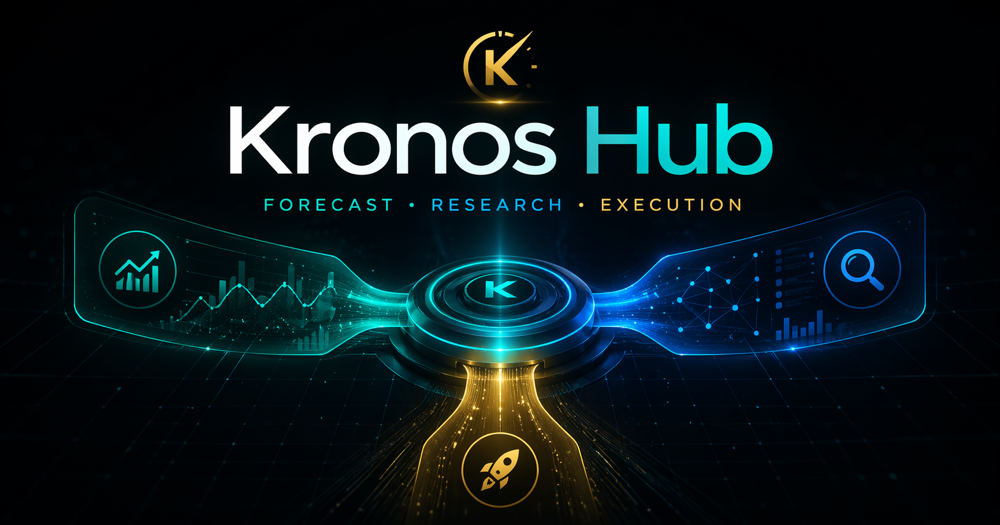
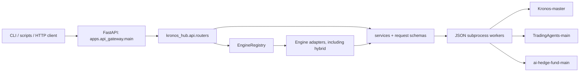

# Kronos Hub

[中文说明](README.zh-CN.md) · [Hosted Docs](https://b1ue13e.github.io/kronos-hub/) · [Architecture](docs/architecture.md) · [API Reference](docs/api.md) · [Development](docs/development.md)

[](LICENSE) [](https://www.python.org/) [](https://fastapi.tiangolo.com/)

Kronos Hub is an integration-first FastAPI gateway for three vendored projects with different dependencies and product boundaries: `Kronos-master/` forecasts OHLCV time series, `TradingAgents-main/` runs multi-agent research, and `ai-hedge-fund-main/` provides analysis, execution and backtesting. Instead of merging those runtimes, the hub exposes a shared API, an engine registry and JSON subprocess workers that enter each project with its own Python interpreter.

This repository is an engineering integration workspace and a reference for composing heterogeneous research code. It is for research and education, not investment advice. The root integration layer is Apache-2.0; vendored projects keep their own licenses and notices.

[](docs/architecture.md)

## What the API exposes

| Method and route | Purpose |
| --- | --- |
| `GET /` | Name, version, configured host and port, and docs path |
| `GET /health` | Hub health and engine/subproject counts |
| `GET /engines`, `GET /engines/{engine_name}` | Registered engine metadata and availability |
| `GET /projects` | Discovery of the three vendored project paths and entrypoints |
| `POST /runs` | Unified registry entrypoint for `kronos`, `tradingagents`, `ai_hedge_fund` and `hybrid` |
| `POST /predictions/kronos`, `POST /predictions/kronos/batch` | Single-series and batch OHLCV forecasting |
| `POST /research/tradingagents` | Multi-agent research with ticker, date, analysts and provider options |
| `POST /execution/ai-hedge-fund/run`, `POST /execution/ai-hedge-fund/backtest` | AI Hedge Fund analysis and backtesting |

The `hybrid` adapter runs a real Kronos forecast from `options.history`, builds a hub-side signal summary, and can optionally fan out to TradingAgents research and AI Hedge Fund execution or backtesting. Research and execution expansion requires the corresponding upstream dependencies and credentials. The current bridge passes forecast context through prompts and hub-generated summaries; deeper tool-level fusion, unified UI, result storage and logging remain future work.

Dry-run engine requests return planned commands or contract information without invoking a real worker. Worker failures return HTTP 500 with the captured `stdout` and `stderr` in the response, so missing interpreters and upstream provider errors can be diagnosed from the API response.

## Quick start

The hub itself requires Python 3.10+; each vendored project needs its own environment and dependencies. From the repository root in PowerShell:

```powershell
Copy-Item .env.example .env
pip install -e .
python .\scripts\smoke_check.py
python -m unittest
python -m uvicorn apps.api_gateway.main:app --reload --port 8010
```

Alternatively, `.\scripts\bootstrap_hub.ps1` prepares a dedicated hub environment and `.\scripts\run_api.ps1` starts the gateway using `KRONOS_HUB_HOST` and `KRONOS_HUB_PORT`. Open <http://127.0.0.1:8010/docs> for Swagger and `GET /projects` to check that all three subproject directories were discovered.

`HubSettings.from_env()` loads `.env` without overriding existing environment variables. Set `KRONOS_HUB_KRONOS_PATH`, `KRONOS_HUB_TRADINGAGENTS_PATH` and `KRONOS_HUB_AI_HEDGE_FUND_PATH` when the vendored directories live elsewhere, and set `KRONOS_HUB_KRONOS_PYTHON`, `KRONOS_HUB_TRADINGAGENTS_PYTHON` and `KRONOS_HUB_AI_HEDGE_FUND_PYTHON` to point each worker to an isolated interpreter. Provider keys such as `OPENAI_API_KEY`, `ANTHROPIC_API_KEY`, `GOOGLE_API_KEY`, `ALPHA_VANTAGE_API_KEY` and `FINANCIAL_DATASETS_API_KEY` are optional and only needed by upstream flows. Keep `.env` out of version control.

## Try a request

The repository contains request templates and PowerShell callers under `examples/requests/` and `examples/scripts/`. With the gateway running:

```powershell
.\examples\scripts\invoke-kronos-sample.ps1
.\examples\scripts\invoke-hybrid-demo.ps1
.\examples\scripts\invoke-hybrid-demo.ps1 -EnableResearch
.\examples\scripts\invoke-hybrid-demo.ps1 -EnableResearch -EnableExecution
.\examples\scripts\invoke-tradingagents-sample.ps1
.\examples\scripts\invoke-aihf-run-sample.ps1
.\examples\scripts\invoke-aihf-backtest-sample.ps1
```

Start with [examples/README.md](examples/README.md) and the [hybrid demo template](examples/requests/hybrid.demo.template.json). The API reference lists required and optional fields for each route. A successful forecast requires the Kronos model dependencies in the configured Kronos interpreter; a successful research or execution call also requires a working upstream model/data provider configuration.

## Architecture



| Path | Responsibility |
| --- | --- |
| `apps/api_gateway/main.py` | Uvicorn application entrypoint |
| `kronos_hub/api/` | FastAPI app, routers, Pydantic request bodies and dependencies |
| `kronos_hub/settings.py`, `kronos_hub/shared/project_paths.py` | Environment loading, host/port and subproject discovery |
| `kronos_hub/engines/` | Registry and the kronos, tradingagents, ai_hedge_fund and hybrid adapters |
| `kronos_hub/services/` | Parameter mapping and worker invocation |
| `kronos_hub/workers/` | JSON payload boundaries for each vendored project |
| `tests/`, `scripts/smoke_check.py`, `examples/` | Unit tests, self-check and runnable request examples |
| `Kronos-master/`, `TradingAgents-main/`, `ai-hedge-fund-main/` | Vendored upstream projects with their own licenses |

The request flow is: a client calls the API, the router validates a Pydantic body, a service or registry adapter builds a worker payload, a separate process enters the target subproject, and the result is normalized into a JSON contract. This boundary keeps LangGraph/LangChain and PyTorch/Hugging Face dependencies from being forced into one environment. See [Architecture](docs/architecture.md) and [Development](docs/development.md) for the design rationale and extension sequence.

## Development and docs

```powershell
python .\scripts\smoke_check.py
python -m unittest
```

When adding an engine, update its adapter, service, worker, registry, router or `/runs` contract, request template and test together. [CONTRIBUTING.md](CONTRIBUTING.md) covers contribution guidance, [SECURITY.md](SECURITY.md) covers reporting, and [docs/github-branding.md](docs/github-branding.md) records the hosted-docs presentation. [MERGE_ASSESSMENT.md](MERGE_ASSESSMENT.md) preserves the original integration notes.

- [API Reference](docs/api.md): routes, payload fields, hybrid options and error diagnosis
- [Architecture](docs/architecture.md): runtime boundaries and worker design
- [Development](docs/development.md): multi-interpreter setup, module roles and extension steps
- [Examples](examples/README.md): request templates and scripts
- [Third-Party Notices](THIRD_PARTY_NOTICES.md), [NOTICE](NOTICE), [LICENSE](LICENSE): license boundaries for the integration layer and vendored projects

The current limits are explicit: TradingAgents consumes forecast context in prompts rather than through deep tool-level fusion, hybrid signal synthesis remains hub-side, AI Hedge Fund is not fully re-centered on the gateway, and a shared UI/result store/logging layer is not yet implemented. The roadmap in [Development](docs/development.md) describes these as next steps.
